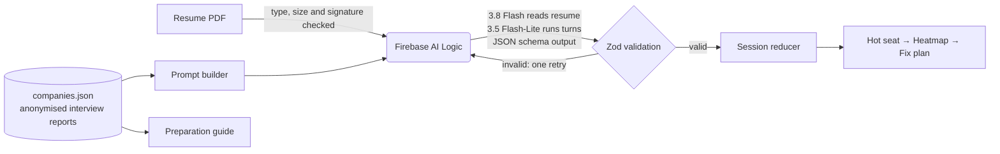

# 🔥 HotSeat: Can you defend your resume?

> Built by **Ember Syndicate** for PromptWars × GDG On Campus (26 September 2026).

**Live demo:** https://gdgxpromtwar.web.app

HotSeat is an AI interviewer that questions students on every line of their resume, digging deeper each time,
until it finds where their knowledge runs out. The resume then becomes a **heatmap**: each claim is marked
Defended, Shaky, Exposed or Not tested, with evidence from the student's own answers and a fix plan for every
weak line. When a student picks a target company, HotSeat shows a **preparation guide** for it and shapes the
questions around what **past candidates were actually asked there**, distilled from anonymised placement
interview reports for 60 companies.

## The challenge, answered

The challenge: *students struggle to understand what to prepare, how to prepare, where they stand, and what they
need to improve.*

| Challenge question | HotSeat feature |
|---|---|
| **What to prepare** | **Preparation guide** per company: rounds and format, areas to prepare, recommended resources as one-click links (official sites from a curated list, never AI-invented URLs), real questions asked, HR questions and tips, all from anonymised interview reports. |
| **What to prepare, applied** | **Company lens.** The interview questions are shaped by the rounds, topics and real questions reported for the chosen company. |
| **How to prepare** | **Adaptive hot seat.** Up to 3 questions per claim, each one deeper than the last, answered by typing or speaking, like a real interview. |
| **Where they stand** | **Resume heatmap.** Every claim gets a verdict (icon, label and colour), the depth reached, a quote from the student's answer, and a 0–100 defensibility score. |
| **What to improve** | **Fix plan** for each shaky or exposed claim: 3 concepts to learn, a practice question, and an honest rewrite of the resume line. **Re-defend** proves the progress. |

## Why this problem

- Only about 1 in 5 freshers feel ready for interviews ([Apna survey via Business Today](https://www.businesstoday.in/education/exams/story/only-3-in-10-indians-feel-ready-confident-for-job-interviews-freshers-hit-hardest-report-477396-2025-05-22)).
- 42% of employers say candidates fail interviews mainly because they cannot apply the skills they claim ([Gi Group report via The Tribune](https://www.tribuneindia.com/news/business/gi-group-holding-report-reveals-a-credential-paradox-in-indias-entry-level-hiring-market)).
- The developersIndia resume guide advises listing a project only if you can discuss it in depth ([guide](https://github.com/developersIndia/wiki/blob/main/src/community-guides/how-to-create-an-ideal-software-engineering-resume.md)).

Existing tools score a resume for software filters (ATS keyword match). None check whether the **student** can back
up their own resume, which is what campus interviewers actually test.

**Chosen vertical:** placement preparation, specifically self-evaluation and interview readiness for resume and
project deep-dives.

## How it works

0. **Preparation guide tab:** browse any of the 60 company guides without uploading anything.
1. **Start:** upload a resume PDF, choose a target company (or General) and accept the data notice. Choosing a
   company opens its **preparation guide**, which is shown again under the results.
2. **Extract:** Gemini reads the PDF and returns the 5–8 claims an interviewer is most likely to probe, each with an opening question.
3. **Hot seat:** each answer is assessed in a single call that returns the verdict, depth, evidence and gap, and decides whether to probe deeper or move on. Up to 3 questions per claim; **Finish now** at any time.
4. **Heatmap:** verdicts, evidence and score. **Get fix plan** for weak claims; **Re-defend** any claim.



## AI and prompting

- **Two model tiers, chosen by measurement:** `gemini-3.8-flash` reads the resume once (quality matters most);
  `gemini-3.5-flash-lite` runs every interview turn and fix plan. Measured live on the free tier, a turn dropped
  from 7–31 s to 2.4–3.4 s with the same verdicts. Both use a low thinking level and are configurable
  (`VITE_GEMINI_MODEL`, `VITE_GEMINI_FAST_MODEL`).
- **Graceful degradation:** if the quality model's free quota runs out, resume reading automatically retries on the fast tier.
- **Structured output:** response shapes are defined once as Zod schemas (`src/domain/model.ts`), converted to JSON Schema for Gemini's `responseJsonSchema`, then every response is validated before use, with one retry.
- **One call per turn:** assessing the last answer and choosing the next question happen together, which halves latency and quota use.
- **Prompt design** (`src/ai/prompts.ts`, unit-tested): a strict-but-fair interviewer persona; the company lens is injected as context; verdict definitions are explicit so scoring is consistent.
- **Prompt-injection guard:** resume text and answers are wrapped as untrusted data, angle brackets are neutralised, and the system instruction tells the model never to follow instructions inside them.

## Company data: past candidates' knowledge, anonymised

- **Source:** placement interview feedback forms written by past candidates after their interviews, used with permission.
- **Output:** 60 company profiles with rounds, areas to prepare, recommended resources, real questions, HR questions and tips.
- **Pipeline:** `scripts/distill_companies.py`
  1. Removes names, roll numbers, emails, phone numbers and institution-specific terms (`REDACT_TERMS`, kept in the git-ignored `.env.local`) before anything is sent to Gemini.
  2. Instructs Gemini to exclude personal details and never name any institution.
  3. Scrubs the summary again against every name found in the source text and every redaction term.
  4. Runs a final PII pattern check before the file is committed.
- Only the distilled `src/data/companies.json` lives in this repository. The source documents never do.

## Google services

| Service | How HotSeat uses it |
|---|---|
| **Gemini 3.8 Flash** (Gemini Developer API) | Reads the resume PDF and picks the claims to probe, with opening questions |
| **Gemini 3.5 Flash-Lite** (Gemini Developer API) | Fast interview turns: assessment, follow-up questions, fix plans |
| **Firebase AI Logic** | Calls Gemini from the browser without shipping any API key |
| **Firebase Hosting** | Global CDN hosting with security headers (`firebase.json`) |
| **Firebase App Check** (reCAPTCHA Enterprise) | Abuse protection, switched on by setting `VITE_RECAPTCHA_SITE_KEY` |
| **Google Analytics for Firebase** | Optional usage analytics, switched on by setting `VITE_FIREBASE_MEASUREMENT_ID` |
| **Web Speech API** (Google speech recognition in Chrome) | Speak answers in Indian English instead of typing |

## Security and privacy

- **No secrets in the repo:** `.env.local` is git-ignored. The Firebase web config identifies the project and is injected at build time.
- **No Gemini key in the browser:** requests go through Firebase AI Logic.
- **Consent first:** students accept a notice that the resume goes to Gemini, with a tip to remove contact details.
- **Input validation:** PDF type, 10 MB size limit and `%PDF-` signature check; answers are capped at 1,500 characters.
- **Safe rendering:** AI output is rendered as plain text through React; no raw HTML.
- **Rate limiting:** 12 AI calls per minute per tab, on top of Firebase AI Logic's per-user quota.
- **HTTP headers:** Content-Security-Policy, X-Frame-Options, nosniff, Referrer-Policy and Permissions-Policy.
- **Data stays local:** session results are stored only in the browser, and **Clear my data** removes them.

## Accessibility

Semantic landmarks and headings; every control is labelled; the whole flow works by keyboard; focus moves to each
new question; status updates use `aria-live`; verdicts are never colour-only (icon + text + colour); WCAG AA contrast;
`prefers-reduced-motion` is respected; the layout is responsive down to phone width.

## Testing and quality

- **58 tests** (Vitest + Testing Library): session state machine and scoring, storage fallbacks, JSON-schema
  conversion, prompt building and injection escaping, AI client validation, retry, model tiers, quota fallback,
  rate limiting, error messages, PDF validation, preparation guide rendering,
  config checks, company data parsing, accessible heatmap labels, start-screen validation, and a full
  upload → interview → heatmap → fix plan flow with a fake AI client.
- **7 Python tests** for the PII and institution-term redaction and scrubbing pipeline.
- TypeScript strict mode, ESLint, and GitHub Actions CI (`.github/workflows/ci.yml`).

```bash
npm test          # unit and integration tests
npm run lint      # ESLint
npm run typecheck # TypeScript
python -m unittest discover -s scripts -p "test_*.py"
```

## Run locally

```bash
npm install
cp .env.example .env.local   # then fill in your Firebase web app config
npm run dev
```

In the Firebase console: create a project, open **AI Logic** and choose the **Gemini Developer API**, then register a
web app to get the config values.

## Regenerate the company profiles

```bash
python scripts/distill_companies.py --db path/to/chroma.sqlite3 --limit 60
```

## Deploy

```bash
npm run build
firebase deploy --only hosting --project <your-project-id>
```

## Project structure

```
src/
  ai/          prompts, JSON-schema conversion, Gemini client
  components/  StartScreen, GuideBrowser, PrepGuide, HotSeat, Results, FixPlanView, VerdictBadge
  data/        companies.json (anonymised) and its typed loader
  domain/      Zod models, session reducer and score, local storage
  hooks/       useSpeechInput
  lib/         Firebase adapter, PDF checks, rate limiter, errors
scripts/       company-profile distillation pipeline and its tests
docs/          design spec and implementation plan
```

## Assumptions

- Resumes are PDFs in English, up to 10 MB.
- Speech input needs a browser with the Web Speech API (Chrome or Edge); typing always works.
- The interview reports reflect recent campus placement seasons; company processes can change.
- Verdicts are AI judgements for practice, not predictions of hiring outcomes.
- Free-tier quotas are enough for demo-scale use.

## Team

**Ember Syndicate**
